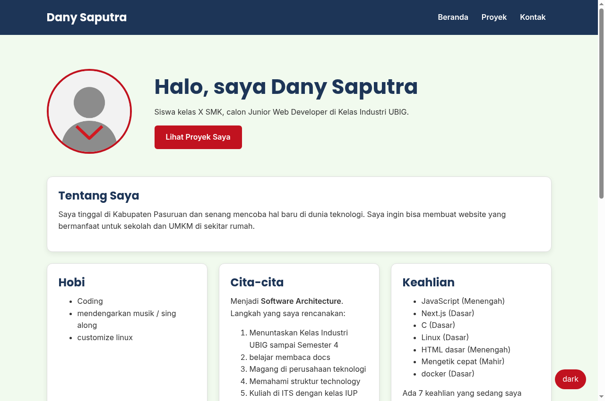

# 🌐 Portofolio Pribadi — Dany Saputra

> Website portofolio personal yang dikembangkan dalam rangka **Kelas Industri UBIG (PT Universal Big Data)** — Paket 1 Full Stack Basic.

## 📌 Deskripsi Proyek

Proyek ini adalah website portofolio v1 yang dirancang responsif (tampil rapi di ponsel, tablet, dan laptop) menggunakan HTML5 dan CSS3 murni (Flexbox & Media Queries), serta dilengkapi modul interaktif JavaScript modern (kalkulator berbasis state, formulir penjumlahan dinamis, utilitas logika matematika, skrip demonstrasi, implementasi *Object-Oriented Programming* / OOP, dan dokumentasi JSDoc). 

Proyek ini juga menerapkan **Automated Unit Testing** menggunakan test runner bawaan Node.js (`node:test`), dikelola menggunakan **Git** sebagai version control system, disimpan di repositori remote **GitHub**, dan dipublikasikan secara otomatis (*CI/CD Deployment*) melalui **Vercel**.

* **Website Live:** <https://portofolio-dany-saputra.vercel.app/> atau <https://portfolio-smk.danix.my.id/>
* **Repositori GitHub:** <https://github.com/danysaoutraXRPL1Skensapas/portofolio-dany-saputra>

## 🖼️ Tampilan Website



## ✨ Fitur Utama

* **Beranda (`index.html`):** Memuat profil singkat, tentang saya, hobi, cita-cita (*Software Architect*), daftar keahlian, dan jadwal belajar mandiri.
* **Proyek (`proyek.html`):** Menampilkan daftar hasil karya/proyek yang pernah dikerjakan (Halaman Profil, Form Kontak, Tabel Jadwal) beserta FAQ interaktif menggunakan elemen `<details>`.
* **Kontak (`kontak.html`):** Menyediakan formulir pesan interaktif dengan validasi HTML dasar serta informasi media sosial.
* **Aplikasi Kalkulator Modern (`mycalc.html`):** Kalkulator berbasis grid Bootstrap dengan arsitektur *state machine* untuk operasi aritmatika (`+`, `-`, `*`, `/`), operasi desimal, tombol hapus satu per satu (`DEL`), dan reset (`C`).
* **Kalkulator Form Sederhana (`kalkulator.html`):** Demonstrasi manipulasi DOM berbasis form penjumlahan 3 input angka.
* **Modul Logika & Matematika (`js/logika.js`):** Kumpulan fungsi utilitas teruji seperti penentuan bilangan ganjil/genap, konversi Celsius ke Fahrenheit, pencarian nilai terbesar, penentuan tahun kabisat, dan kalkulasi diskon bertingkat.
* **Demonstrasi Logika Konsol (`js/logika-demo.js`):** Skrip demonstrasi eksekusi pengujian logika langsung pada konsol browser/terminal.
* **Pemrograman Berorientasi Objek / OOP (`js/oop/siswa.js`):** Implementasi kelas `Student` modern dengan proteksi properti privat (`#IMMUTABLE_KEYS`), validasi mutasi nilai, kalkulasi nilai rata-rata tugas, dan penentuan kriteria kelulusan (KKM).
* **Desain Responsif:** Dibuat dengan pendekatan *mobile-first* menggunakan Flexbox, CSS Media Queries, dan navigasi ramah seluler.
* **CI/CD Auto-Deploy:** Setiap pembaruan kode (`git push`) ke *branch* `main` secara otomatis memperbarui versi *live* di Vercel.

## 🛠️ Teknologi & Alat Kerja

* **Bahasa & Pemformatan:** HTML5, CSS3 (Google Fonts: Poppins & Inter, Bootstrap Grid)
* **Bahasa Pemrograman (Logic):** JavaScript (ES6+ Modules, OOP, JSDoc Documentation)
* **Pengujian Otomatis:** Node.js Native Test Runner (`node:test` & `node:assert`)
* **Environment & Package Manager:** Node.js & npm (`live-server` untuk local dev server)
* **Version Control:** Git
* **Remote Repository:** GitHub
* **Platform Hosting & Deployment:** Vercel
* **Code Editor:** Visual Studio Code (dengan Git Bash & Terminal)

## 📁 Struktur Folder

```text
.
├── css/
│   ├── mycalc.css
│   └── style.css
├── img/
│   ├── foto-profil.png
│   ├── proyek-jadwal.png
│   ├── proyek-jadwal1.png
│   ├── proyek-kontak.png
│   └── proyek-profil.png
├── js/
│   ├── oop/
│   │   └── siswa.js
│   ├── kalkulator.js
│   ├── latihan.js
│   ├── logika-demo.js
│   ├── logika.js
│   ├── logika.test.js
│   ├── mycalc.js
│   └── mycalc.test.js
├── .gitignore
├── README.md
├── index.html
├── kalkulator.html
├── kontak.html
├── mycalc.html
├── package.json
└── proyek.html
```

## 💻 Menjalankan Proyek Secara Lokal

Pastikan Anda telah menginstal [Node.js](https://nodejs.org/) di perangkat Anda:

1. **Jalankan Pengujian Otomatis (Unit Testing):**
   ```bash
   npm test
   # atau
   node --test js/*.test.js
   ```

2. **Jalankan Server Lokal (Development):**
   ```bash
   npm run dev
   ```
   Aplikasi akan otomatis berjalan pada `http://localhost:3000`.

## 🧪 Pengujian Unit (Automated Testing)

Proyek ini telah dilengkapi dengan rangkaian pengujian unit otomatis (*unit testing*) menggunakan modul bawaan Node.js tanpa memerlukan dependensi pihak ketiga. Seluruh modul dan skenario pengujian juga telah didokumentasikan menggunakan format **JSDocs**.

Cakupan pengujian (total 45 tests):
* **`js/logika.test.js` (20 Pengujian):** Menguji akurasi fungsi penentuan ganjil/genap, konversi suhu, perbandingan nilai maksimum (`BestNilaiTerbesar`), aturan tahun kabisat Gregorian, diskon bertingkat, penanganan signed zero (`-0` dan `0`), serta validasi `NaN`.
* **`js/mycalc.test.js` (25 Pengujian):** Menguji kalkulasi aritmatika, pembagian angka nol (`Error`), penanganan input desimal, pemotongan digit (`DEL`), tombol clear (`C`), chaining kalkulasi, hingga simulasi event klik tombol keypad (*DOM event delegation*).

## 🚀 Alur Pengembangan (Git Workflow)

Pengembangan proyek ini mengikuti standar konvensi *Conventional Commits*:

1. **Inisialisasi Repositori Local:** `git init`
2. **Penyaringan File:** Konfigurasi `.gitignore` untuk mengabaikan file sistem (`node_modules/`, `package-lock.json`, `Thumbs.db`, `.DS_Store`, `.vscode/`).
3. **Pencatatan Versi (Commit):**
   * `feat:` Menambah fitur atau halaman baru.
   * `fix:` Memperbaiki kesalahan kode/tautan.
   * `docs:` Memperbarui dokumentasi (`README.md`).
   * `style:` Memperbaiki tata letak / format tampilan CSS.
   * `test:` Menambah atau menyempurnakan skenario unit test.
4. **Pengiriman ke Remote (Push):** Terhubung ke GitHub via `git remote add origin`.
5. **Fitur Branching & Pull Request (PR):**
   * Membuat *branch* pengembangan (seperti `development` atau `fitur-kontak`).
   * Mengajukan Pull Request (PR) di GitHub, menguji *Vercel Preview Deployment*, dan melakukan *merge* ke `main`.

## 👤 Pembuat

**Dany Saputra**  
*Siswa SMK — Calon Junior Web Developer / Software Architect*  
Kelas Industri UBIG (PT Universal Big Data)

* **GitHub:** [@danydevid](https://github.com/danydevid)
* **Email:** study@danix.my.id
* **Reddit:** [mrtrtchnix](https://www.reddit.com/user/mrtrtchnix)

---
*Dibuat dengan semangat belajar di Kelas Industri PT Universal Big Data (UBIG) — Tahun Ajaran 2026/2027.*