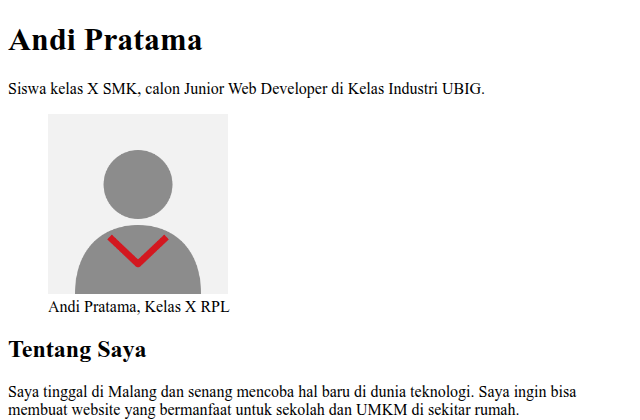

# 🌐 Portofolio Pribadi — Dany Saputra

> Website portofolio personal yang dikembangkan dalam rangka **Kelas Industri UBIG (PT Universal Big Data)** — Paket 1 Full Stack Basic (Minggu 05 / P1-W05).

## 📌 Deskripsi Proyek

Proyek ini adalah website portofolio v1 yang dirancang responsif (tampil rapi di ponsel, tablet, dan laptop) menggunakan HTML5 dan CSS3 murni (Flexbox & Media Queries). Versi ini disinkronkan menggunakan **Git** sebagai version control system, disimpan di repositori remote **GitHub**, dan dipublikasikan secara otomatis (*CI/CD Deployment*) melalui **Vercel**.

* **Website Live:** <https://portofolio-dany.vercel.app> *(sesuaikan dengan URL Vercel kamu)*
* **Repositori GitHub:** <https://github.com/danydevid/portofolio>

## 🖼️ Tampilan Website



## ✨ Fitur Utama

* **Beranda (`index.html`):** Memuat profil singkat, tentang saya, hobi, cita-cita (*Software Architect*), daftar keahlian, dan jadwal belajar mandiri.
* **Proyek (`proyek.html`):** Menampilkan daftar hasil karya/proyek yang pernah dikerjakan (Halaman Profil, Form Kontak, Tabel Jadwal) beserta FAQ interaktif menggunakan elemen `<details>`.
* **Kontak (`kontak.html`):** Menyediakan formulir pesan interaktif dengan validasi HTML dasar serta informasi media sosial.
* **Desain Responsif:** Dibuat dengan pendekatan *mobile-first* menggunakan Flexbox, CSS Media Queries, dan navigasi ramah seluler.
* **CI/CD Auto-Deploy:** Setiap pembaruan kode (`git push`) ke *branch* `main` secara otomatis memperbarui versi *live* di Vercel.

## 🛠️ Teknologi & Alat Kerja

* **Bahasa & Pemformatan:** HTML5, CSS3 (Google Fonts: Poppins & Inter)
* **Version Control:** Git
* **Remote Repository:** GitHub
* **Platform Hosting & Deployment:** Vercel
* **Code Editor:** Visual Studio Code (dengan Git Bash & Terminal)

## 📁 Struktur Folder

```text
.
├── css/
│   └── style.css
├── img/
│   ├── foto-profil.png
│   ├── proyek-jadwal.png
│   ├── proyek-kontak.png
│   └── proyek-profil.png
├── .gitignore
├── README.md
├── index.html
├── kontak.html
└── proyek.html
```

## 🚀 Alur Pengembangan (Git Workflow)

Pengembangan proyek ini mengikuti standar konvensi *Conventional Commits*:

1. **Inisialisasi Repositori Local:** `git init`
2. **Penyaringan File:** Konfigurasi `.gitignore` untuk mengabaikan file sistem (`Thumbs.db`, `.DS_Store`, `.vscode/`).
3. **Pencatatan Versi (Commit):**
   * `feat:` Menambah fitur atau halaman baru.
   * `fix:` Memperbaiki kesalahan kode/tautan.
   * `docs:` Memperbarui dokumentasi (`README.md`).
   * `style:` Memperbaiki tata letak / format tampilan CSS.
4. **Pengiriman ke Remote (Push):** Terhubung ke GitHub via `git remote add origin`.
5. **Fitur Branching & Pull Request (PR):**
   * Membuat *branch* baru `fitur-kontak` untuk penambahan kartu media sosial.
   * Mengajukan Pull Request (PR) di GitHub, menguji *Vercel Preview Deployment*, dan melakukan *merge* ke `main`.

## 👤 Pembuat

**Dany Saputra**  
*Siswa SMK — Calon Junior Web Developer / Software Architect*  
Kelas Industri UBIG (PT Universal Big Data)

* **GitHub:** [@danydevid](https://github.com/danydevid)
* **Email:** study@danix.my.id
* **Reddit:** [mrtrtchnix](https://www.reddit.com/user/mrtrtchnix)

---
*Dibuat dengan semangat belajar di Kelas Industri PT Universal Big Data (UBIG) — Tahun Ajaran 2026/2027.*