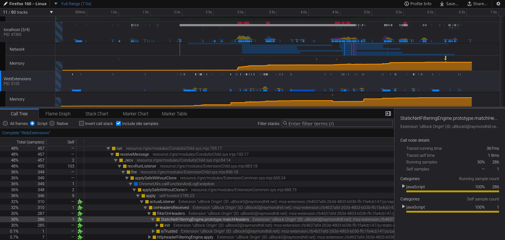

# 🌐 Portofolio Pribadi — Dany Saputra

> Website portofolio personal yang dikembangkan dalam rangka **Kelas Industri UBIG (PT Universal Big Data)** — Paket 1 Full Stack Basic (Minggu 01 – Minggu 09: *HTML5, CSS3 Responsif, Modern JavaScript, Automated Testing, Asynchronous Data, Web Performance, & SEO Optimization*).

## 📌 Deskripsi Proyek

Proyek ini adalah website portofolio yang dirancang responsif (*mobile-first* di ponsel, tablet, dan laptop) menggunakan HTML5 semantik dan CSS3 murni (Flexbox & Media Queries), dilengkapi modul JavaScript modern (pemanggilan data asynchronous via Fetch API, filter kategori dinamis, integrasi GitHub REST API, kalkulator interaktif berbasis state machine, utilitas logika matematika, serta implementasi *Object-Oriented Programming* / OOP berstandar JSDoc).

Proyek ini telah melalui pengujian unit otomatis (*Automated Unit Testing*) bawaan Node.js (`node:test`), audit performa dan aksesibilitas berstandar industri menggunakan **Google Lighthouse** (mencapai skor 84–100 di seluruh kategori) serta profiling runtime menggunakan **Firefox Profiler**. Seluruh kode dikelola menggunakan **Git** (konvensi *Conventional Commits*), disimpan di repositori remote **GitHub**, dan dideploy secara kontinu (*CI/CD Deployment*) melalui **Vercel**.

* **Website Live:** <https://portofolio-dany-saputra.vercel.app/> atau <https://portfolio-smk.danix.my.id/>
* **Repositori GitHub:** <https://github.com/danysaoutraXRPL1Skensapas/portofolio-dany-saputra>

---

## 🖼️ Tampilan Website

### Tampilan Utama (Beranda)


### Pengukuran Kinerja (Firefox Profiler)


---

## ✨ Fitur Utama (Minggu 01 – 09)

* **Beranda (`index.html`):**
  * Hero section personal dengan foto profil teroptimasi aspek rasio (mencegah CLS).
  * Tentang Saya, Hobi, Cita-cita (*Software Architect*), dan Jadwal Belajar Mandiri.
  * **Keahlian Dinamis (Minggu 07 & 09):** Data keahlian dimuat secara asynchronous dari `data/keahlian.json`.
  * **Integrasi GitHub REST API (Minggu 09):** Mengambil 6 repositori publik teratas secara otomatis lengkap dengan bahasa pemrograman dan jumlah bintang (⭐).
* **Proyek (`proyek.html`):**
  * **Daftar Proyek Dinamis (Minggu 07 & 09):** Memuat katalog karya dari `data/proyek.json`.
  * **Filter Kategori Interaktif (4 Tombol):** Menyaring proyek berdasarkan kategori *Semua*, *HTML*, *CSS*, dan *JavaScript* disertai indikator jumlah proyek yang sedang ditampilkan.
  * **Pencegahan Cumulative Layout Shift (CLS):** Penataan wadah `#daftar-proyek { min-height: 30rem; }` dan deklarasi atribut `width` & `height` eksplisit pada seluruh gambar kartu.
  * FAQ interaktif menggunakan elemen semantik `<details>` dan `<summary>`.
* **Kontak (`kontak.html`):**
  * Formulir kontak interaktif dengan validasi native HTML5.
  * **Penghitung Karakter Real-Time:** Indikator panjang karakter pesan (`0/300 karakter`) menggunakan event listener JavaScript.
* **Mode Gelap & Terang (*Dark/Light Mode Theme Toggle*):**
  * Tombol toggle tema mengambang (*floating*) di pojok kanan bawah pada seluruh halaman.
  * Pengaturan tersimpan persisten di `localStorage` dan dieksekusi secara instan (`theme.js`) untuk mencegah efek kedip (*Flash of Unstyled Theme / FOUT*).
* **Aplikasi Kalkulator Modern (`mycalc.html`):**
  * Kalkulator berbasis grid Bootstrap dengan arsitektur *state machine* untuk operasi aritmatika (`+`, `-`, `*`, `/`), desimal, hapus satu karakter (`DEL`), dan reset (`C`).
* **Kalkulator Form Sederhana (`kalkulator.html`):**
  * Demonstrasi manipulasi DOM berbasis form penjumlahan 3 input angka.
* **Modul Logika & Matematika (`js/logika.js`):**
  * Kumpulan fungsi utilitas teruji: bilangan ganjil/genap, konversi Celsius ke Fahrenheit, pencarian nilai maksimum, tahun kabisat Gregorian, dan diskon bertingkat.
* **Pemrograman Berorientasi Objek / OOP (`js/oop/siswa.js`):**
  * Implementasi kelas `Student` modern dengan proteksi properti privat (`#IMMUTABLE_KEYS`), validasi mutasi nilai, rata-rata tugas, dan penentuan kriteria kelulusan (KKM).

---

## 📊 Pengujian Kinerja & Kualitas Web (Performance & Audit)

### 1. Audit Google Lighthouse
Pengujian dilakukan terhadap 3 halaman utama portofolio dengan target skor **minimal 80 pada seluruh 4 kategori**:

| Halaman | Performance | Accessibility | Best Practices | SEO | Status |
|---|:---:|:---:|:---:|:---:|:---:|
| **Beranda (`index.html`)** | **84** (Mobile) / **96** (Desktop) | **100** | **100** | **100** | ✅ **Lulus (>= 80)** |
| **Proyek (`proyek.html`)** | **91** (Mobile) / **98** (Desktop) | **90** | **100** | **100** | ✅ **Lulus (>= 80)** |
| **Kontak (`kontak.html`)** | **95** (Mobile) / **100** (Desktop) | **100** | **100** | **100** | ✅ **Lulus (>= 80)** |

**Optimasi yang diterapkan:**
* **Accessibility (100):** Rasio kontras warna teks dan aksen ditingkatkan ke `#C1121F` (lolos standar WCAG AA/AAA) serta kelengkapan atribut `alt` deskriptif pada seluruh gambar.
* **Best Practices & SEO (100):** Penambahan tag `<meta name="description">` yang unik dan relevan pada setiap halaman.
* **Performance & CLS:** Penerapan dimensi `width` dan `height` eksplisit pada gambar serta deklarasi `#daftar-proyek { min-height: 30rem; }` untuk mengeliminasi pergeseran tata letak saat data JSON dimuat secara asinkron.

### 2. Analisis Firefox Profiler
Pengukuran runtime menggunakan Firefox Profiler (tersimpan pada `data/Firefox 2026-11-14 17.19 profile.json`):

* **Lingkungan Pengujian:** Mozilla Firefox (GeckoMain Engine), `http://localhost:3000/index.html`.
* **Largest Contentful Paint (LCP):** `2.78 s` pada pemuatan awal dan `1.04 s` pada pemuatan berulang (*cached*).
* **DOM Interactive:** `~2.55 s`.
* **DOM Complete:** `~3.28 s`.
* **Efisiensi Thread:** Bebas *long tasks* berat, penanganan asinkron microtasks berjalan mulus tanpa frame drop signifikan.

---

## 🛠️ Teknologi & Alat Kerja

* **Struktur & Tampilan:** HTML5 Semantik, CSS3 Murni (Custom Properties/Variables, Flexbox, Media Queries, Mobile-First Design).
* **Logika & Asinkron:** JavaScript Modern ES6+ (Fetch API, Promises, Async/Await, Array Methods, DOM Manipulation, OOP & JSDoc).
* **Audit & Profiling:** Google Lighthouse CLI (`lighthouse`), Mozilla Firefox Profiler.
* **Pengujian Otomatis:** Node.js Native Test Runner (`node:test` & `node:assert`).
* **Environment & Dev Server:** Node.js & npm (`live-server` untuk local dev server).
* **Version Control & CI/CD:** Git (Conventional Commits), GitHub, Vercel Automated Deployment.
* **Code Editor:** Visual Studio Code.

---

## 📁 Struktur Folder

```text
.
├── css/
│   ├── mycalc.css
│   └── style.css
├── data/
│   ├── Firefox 2026-11-14 17.19 profile.json
│   ├── keahlian.json
│   └── proyek.json
├── img/
│   ├── firefox-performance.png
│   ├── foto-profil.png
│   ├── profil-proyek.png
│   ├── proyek-jadwal.png
│   ├── proyek-jadwal1.png
│   ├── proyek-kalkulator.png
│   ├── proyek-kontak.png
│   ├── proyek-logika.png
│   ├── proyek-profil.png
│   └── proyek-responsif.png
├── js/
│   ├── oop/
│   │   └── siswa.js
│   ├── kalkulator.js
│   ├── latihan.js
│   ├── logika-demo.js
│   ├── logika.js
│   ├── logika.test.js
│   ├── main.js
│   ├── mycalc.js
│   ├── mycalc.test.js
│   └── theme.js
├── .gitignore
├── README.md
├── index.html
├── kalkulator.html
├── kontak.html
├── mycalc.html
├── package.json
└── proyek.html
```

---

## 💻 Menjalankan Proyek Secara Lokal

Pastikan Anda telah menginstal [Node.js](https://nodejs.org/) di perangkat Anda:

1. **Jalankan Pengujian Otomatis (Unit Testing):**
   ```bash
   npm test
   # atau
   node --test js/*.test.js
   ```

2. **Jalankan Server Lokal (Development):**
   ```bash
   npm run dev
   ```
   Aplikasi akan otomatis berjalan pada `http://localhost:3000`.

---

## 🧪 Pengujian Unit (Automated Testing)

Proyek ini telah dilengkapi dengan rangkaian pengujian unit otomatis (*unit testing*) menggunakan modul bawaan Node.js tanpa memerlukan dependensi pihak ketiga (total 45 tests):

* **`js/logika.test.js` (20 Pengujian):** Menguji akurasi fungsi penentuan ganjil/genap, konversi suhu, perbandingan nilai maksimum (`BestNilaiTerbesar`), aturan tahun kabisat Gregorian, diskon bertingkat, penanganan signed zero (`-0` dan `0`), serta validasi `NaN`.
* **`js/mycalc.test.js` (25 Pengujian):** Menguji kalkulasi aritmatika, pembagian angka nol (`Error`), penanganan input desimal, pemotongan digit (`DEL`), tombol clear (`C`), chaining kalkulasi, hingga simulasi event klik tombol keypad (*DOM event delegation*).

---

## 🚀 Alur Pengembangan (Git Workflow)

Pengembangan proyek ini mengikuti standar konvensi *Conventional Commits*:

1. **Inisialisasi Repositori Local:** `git init`
2. **Penyaringan File:** Konfigurasi `.gitignore` untuk mengabaikan file dependensi dan temporary files (`node_modules/`, `package-lock.json`, dll).
3. **Pencatatan Versi (Commit):**
   * `feat:` Menambah fitur atau modul baru (Fetch API, data dinamis, filter kategori).
   * `fix:` Memperbaiki kesalahan kode/tautan/kontras warna/atribut gambar.
   * `docs:` Memperbarui dokumentasi (`README.md`).
   * `perf:` Mengoptimasi Cumulative Layout Shift (CLS) dan waktu render.
   * `test:` Menambah atau menyempurnakan skenario unit test.
4. **Pengiriman ke Remote (Push):** Terhubung ke GitHub via remote origin.
5. **Fitur Branching & Pull Request (PR):**
   * Bekerja melalui *feature branch* (seperti `development`, `feat/week9`).
   * Meninjau hasil melalui *Vercel Preview Deployment* dan melakukan *merge* ke `main`.

---

## 👤 Pembuat

**Dany Saputra**  
*Siswa SMK — Calon Junior Web Developer / Software Architect*  
Kelas Industri UBIG (PT Universal Big Data)

* **GitHub:** [@danydevid](https://github.com/danydevid)
* **Email:** study@danix.my.id
* **Reddit:** [mrtrtchnix](https://www.reddit.com/user/mrtrtchnix)

---
*Dibuat dengan semangat belajar di Kelas Industri PT Universal Big Data (UBIG) — Paket 1 Full Stack Basic (2026).*
